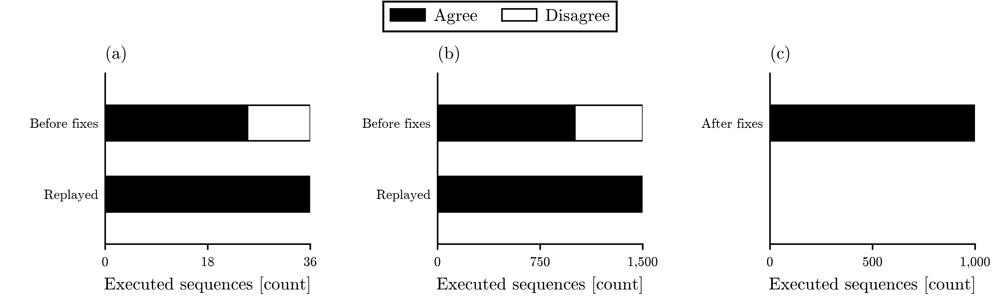
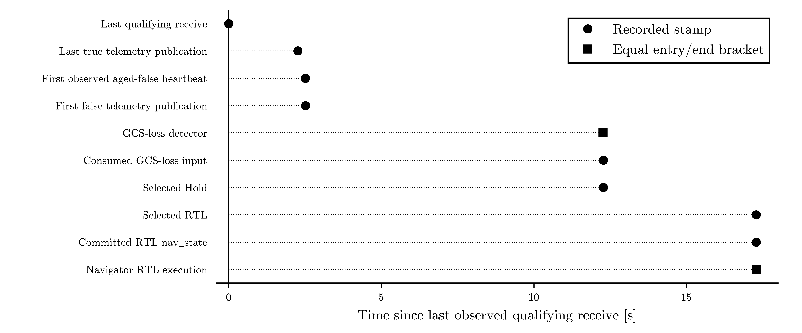

# Results

No study result is available for Study A. Confirmation is incomplete and paused under the
[owner direction](../docs/decision-log.md#2026-10-06-adopt-the-control-prototype-deployment-investigation).
The repository does contain executed component and development results.

| Evidence | Source and reproduction |
| --- | --- |
| Native PX4 unit tests | [Component packet](../evidence/task-oracle-2026-09-26/README.md) |
| Repaired model against the native class, within the declared domain | [Domain and commands](../evidence/task-domain-2026-10-03/README.md), [results](../evidence/task-domain-2026-10-03/results.json) |
| Typed parameter repair and datalink Hold then RTL | [Runtime packet](../evidence/task-runtime-2026-09-29/README.md) |
| Fresh matched builds and datalink observation | [Qualification and commands](../evidence/task-observation-qualification-2026-10-04/README.md), [results](../evidence/task-observation-qualification-2026-10-04/results.json) |
| Sampled public geofence timeline; no admitted replay | [Public-log packet](../evidence/task-public-flight-2026-10-04/README.md), [results](../evidence/task-public-flight-2026-10-04/results.json) |

## Component comparison

Sequence-level agreement between the Python model and the native PX4 failsafe
class. Panels: (a) directed development, (b) random development, (c) fresh
reserved corpus; each panel has its own count axis. A filled bar counts
sequences on which the two agree; a hollow bar counts disagreements. Before
the fixes: directed, 25 of 36 agreed and 11 disagreed; random, 1,005 of 1,500
agreed and 495 disagreed. Replayed after the fixes: directed, 36 of 36 agreed;
random, 1,500 of 1,500 agreed. Fresh reserved corpus after the fixes: 1,000 of
1,000 agreed. Unit: one complete sequence. Development replays reuse inputs;
the fresh corpus is separate from Study A confirmation. The generated cohorts
had 0 invalid and 0 excluded sequences; 8 separate unsupported-input probes
were rejected before either adapter. Corpus agreement only: RC loss, mode
switching, pilot takeover and integrated behavior are excluded. Source:
evidence/task-domain-2026-10-03/results.json. Values: tables.md and
component-agreement.csv.

[Caption file](figures/component-agreement.caption.md) ·
[Accessible table and CSV](figures/tables.md#component-comparison) with
all attempted, invalid and excluded counts, plus separate admission probes ·
[SVG](figures/component-agreement.svg).

## Observed datalink path

Datalink stages from one instrumented SIH development run, on one vehicle HRT
clock. Each row is one stage; the axis is time since the last observed
qualifying heartbeat receive. Circles mark recorded stamps; squares mark the
GCS-loss detector and Navigator RTL execution brackets, whose entry and end
stamps are equal. Time after the last qualifying receive: Last true telemetry
publication, 2.260 s; First observed aged-false heartbeat, 2.512 s; First
false telemetry publication, 2.516 s; GCS-loss detector, 12.268 s; Consumed
GCS-loss input, 12.280 s; Selected Hold, 12.280 s; Selected RTL, 17.284 s;
Committed RTL nav_state, 17.284 s; Navigator RTL execution, 17.284 s. The host
cut has no upper bound and is omitted from the axis. Lockstep quantization
does not measure host execution time. Navigator execution is not actuator
response. Timing is descriptive and outside pass/fail. Source:
evidence/task-observation-qualification-2026-10-04/results.json. Exact
microseconds: datalink-observations.csv.

The clean control has no internal observation markers, so this is not an
overhead comparison.
[Caption file](figures/datalink-observations.caption.md) ·
[Accessible stages and exact microsecond CSV](figures/tables.md#instrumented-datalink-observations) ·
[SVG](figures/datalink-observations.svg) ·
[Cadence, gaps, typed parameters and binary identity](../evidence/task-observation-qualification-2026-10-04/results.json).

## Reproduction and limits

Each packet states its pin, inputs, exclusions, source hashes and raw-archive
location. The [README checks](../README.md#quick-start) exercise retained code.
Component agreement and development observations do not complete the
[Study A coverage gate](../docs/specs/formal-composition/study-a-protocol.md).
The software successor's numerical result and hosted reproduction are published
in [control-code-verification](https://github.com/500ft/control-code-verification).
They qualify development numerical agreement; integration remains unqualified.

The development runs are never held-out confirmation and never a measured
physical-flight result.
